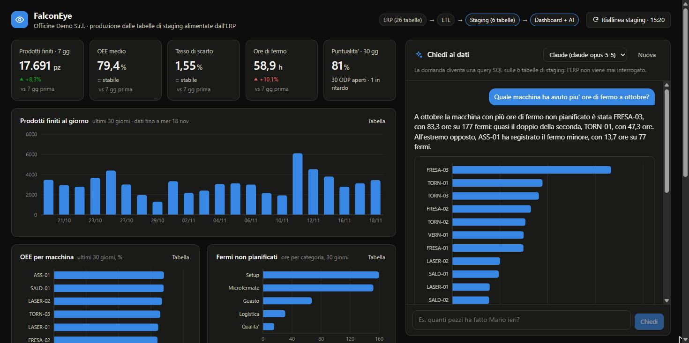
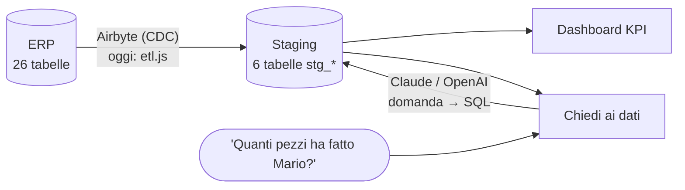
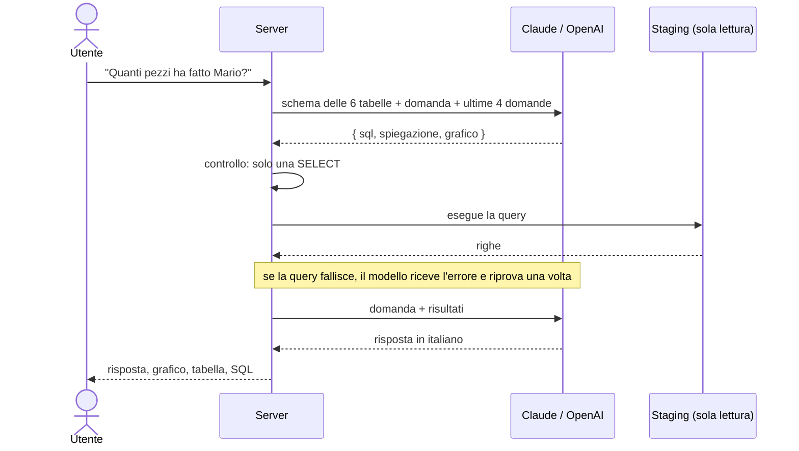

<div align="center">

# 🦅 FalconEye

**Chiedi ai dati di produzione in italiano, senza toccare l'ERP.**

Dashboard e assistente AI su tabelle di staging alimentate dall'ERP: *"quanti pezzi ha fatto Mario
questa settimana?"* diventa una query SQL, un numero, un grafico.




</div>

## Il problema

L'ERP di produzione gira su SQL Server ed è già sotto carico. Ogni report o domanda estemporanea
("quanti pezzi ha fatto il turno di notte?") significa una query in più su un database che non ne
regge altre, e qualcuno che sappia scriverla.

## L'idea



1. **L'ERP non viene mai interrogato dagli utenti.** I dati di produzione vengono copiati in 6 tabelle
   di staging, denormalizzate e già pronte per l'analisi.
2. **La dashboard mostra i KPI**: prodotti finiti, OEE, scarti, fermi, puntualità, ordini in ritardo.
3. **Chiedi ai dati**: Claude o OpenAI trasformano la domanda in SQL. Il server la esegue in sola
   lettura sullo staging, e il modello trasforma i risultati in una risposta in italiano, con grafico
   e tabella.

## Alimentare lo staging: Airbyte

Nella demo lo staging è ricostruito da uno script (`server/db/etl.js`). In produzione al suo posto si
usa **[Airbyte](https://airbyte.com)**, la piattaforma open source per spostare dati tra sistemi:

- **legge il log delle transazioni di SQL Server (CDC)** e non esegue query pesanti sull'ERP;
- porta **solo le righe cambiate**, ogni 15 minuti o con la frequenza voluta;
- ha già il **connettore MSSQL** e i connettori per Postgres o SQL Server come destinazione,
  configurabili dall'interfaccia web;
- è **self-hosted**, quindi i dati non escono dall'azienda.

Le trasformazioni da tabelle ERP a tabelle `stg_*` diventano modelli **dbt**: sono le stesse query di
`etl.js`. La dashboard e l'AI non cambiano.

👉 Architettura, tabelle da sincronizzare, configurazione di SQL Server e un esempio di modello dbt:
**[docs/airbyte.md](docs/airbyte.md)**

## Avvio rapido

Requisiti: Node 22 o superiore.

```powershell
npm install
npm run db:reset        # crea l'ERP fittizio (90 giorni fino a oggi) e lancia l'ETL
copy .env.example .env  # poi inserisci ANTHROPIC_API_KEY oppure OPENAI_API_KEY
npm run dev             # API su :3001 + dashboard su http://localhost:5173
```

Senza chiave si può scegliere **"Demo offline"** nel menu della chat: risponde con regole fisse, senza
AI, solo alle domande di esempio. Serve da paracadute se durante la presentazione manca la rete.

> Rilancia `npm run db:reset` il giorno della demo, così "oggi" e "questa settimana" hanno dati.

## Domande da provare

| Domanda | Cosa mostra |
|---|---|
| Quanti pezzi ha fatto Mario questa settimana? *(poi: "e la settimana scorsa?")* | la ricerca per nome e il contesto della conversazione |
| Quale macchina ha avuto più ore di fermo a ottobre? | FRESA-03, che ha avuto un guasto al mandrino |
| Tasso di scarto per turno nell'ultimo mese | il turno di Notte scarta di più |
| Chi è l'operatore con il tasso di scarto più alto? | una classifica |
| Andamento dell'OEE della FRESA-03 settimana per settimana | il calo di ottobre e il recupero |
| Quali clienti hanno più ordini consegnati in ritardo? | ritardi per cliente |
| Quante ore di straordinario ha fatto il reparto tornitura questo mese? | presenze |

Ogni risposta mostra anche la query SQL generata (in "Come l'ho calcolato"), il grafico e la tabella
dei risultati.

## I dati

**ERP fittizio** (`data/erp.db`, 26 tabelle). Simula 90 giorni di **Officine Demo S.r.l.**, un'azienda
metalmeccanica inventata: 12 macchine, 40 dipendenti su 3 turni, ordini cliente e di produzione, cicli
di lavoro, distinta base, fermi, scarti, timbrature, magazzino e acquisti. Il seme è fisso, quindi i
dati sono sempre gli stessi, e contengono alcune storie da scoprire con le domande (un guasto in
ottobre, un turno che scarta di più…).

**Staging** (`data/staging.db`, 6 tabelle):

| Tabella | Contenuto |
|---|---|
| `stg_produzione` | una riga per dichiarazione: operatore, macchina, turno, ODP, articolo, fase, pezzi buoni e scarti, minuti |
| `stg_ordini_produzione` | ODP con avanzamento, stato, cliente, consegna prevista, giorni di ritardo |
| `stg_fermi_macchina` | fermi con causale, categoria, pianificato sì/no, durata |
| `stg_scarti` | scarti per causale, con costo stimato |
| `stg_presenze` | presenze, ferie, malattie, straordinari |
| `stg_kpi_macchina_giorno` | OEE giornaliero per macchina (disponibilità × performance × qualità) |

## Come funziona la parte AI



- **Schema nel prompt.** Il modello riceve colonne, descrizioni e valori possibili, letti dal database:
  macchine, turni e operatori esistono davvero e vengono scritti esatti nella query.
- **Output strutturato.** La risposta del modello è un JSON validato contro uno schema
  (`sql`, `spiegazione`, `grafico`).
- **Sicurezza.** La connessione allo staging è in sola lettura. Il server accetta solo una singola
  `SELECT`/`WITH`, blocca `ATTACH`, `PRAGMA` e le istruzioni di scrittura, e restituisce al massimo
  1000 righe (vedi `server/staging.js`).
- **Conversazione.** Le ultime 4 domande vengono passate come contesto, quindi funzionano anche le
  domande di seguito ("e Luigi?", "e a ottobre?").
- **Provider.** Claude (predefinito: `claude-opus-5-5`) oppure OpenAI, scelti dal menu della chat.
  Con Claude è attivo il fallback lato server: se il modello rifiuta una richiesta per i filtri di
  sicurezza, l'API la ripete su un modello di riserva.

## Configurazione (`.env`)

| Variabile | Default | Note |
|---|---|---|
| `ANTHROPIC_API_KEY` | | chiave Claude |
| `CLAUDE_MODEL` | `claude-opus-5-5` | |
| `CLAUDE_EFFORT_SQL` | `medium` | `low` per risposte più veloci |
| `OPENAI_API_KEY` | | chiave OpenAI, opzionale |
| `OPENAI_MODEL` | `gpt-5-mini` | |
| `LLM_PROVIDER` | `claude` | `claude`, `openai` oppure `demo` |
| `API_PORT` | `3001` | Vite gira sulla 5173 e inoltra `/api` qui |

## Struttura

```
server/db/createErp.js   generatore dell'ERP fittizio (seme fisso, dati riproducibili)
server/db/etl.js         ERP -> staging (in produzione: Airbyte + dbt)
server/staging.js        connessione in sola lettura, descrizione dello schema, filtro SQL
server/llm.js            prompt e chiamate a Claude / OpenAI
server/mock.js           provider "Demo offline"
server/index.js          API Express: /api/health, /api/dashboard, /api/ask, /api/etl
src/                     dashboard React (Vite + Recharts)
docs/airbyte.md          come alimentare lo staging con Airbyte
```

## Limiti noti

- SQLite non ha un timeout per le query: una query molto pesante generata dall'AI bloccherebbe il
  server finché non termina. Con queste dimensioni di dati non succede in pratica. Su Postgres o SQL
  Server si imposta un timeout per istruzione.
- Per passare a SQL Server o Postgres basta sostituire `better-sqlite3` in `server/staging.js` e
  indicare al modello il dialetto nel prompt (`server/llm.js`).
