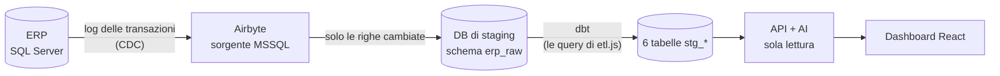

# Alimentare lo staging con Airbyte

Nella demo l'ETL è uno script (`server/db/etl.js`) che legge l'ERP fittizio e ricostruisce le 6 tabelle
di staging. Con l'ERP vero, che è su SQL Server ed è già sotto carico, quel ruolo lo prende
**[Airbyte](https://airbyte.com)**, una piattaforma open source per spostare dati tra sistemi.

## Architettura in produzione



1. **Airbyte copia le tabelle ERP che servono** (17 su 26, elenco sotto) in uno schema grezzo,
   `erp_raw`, su un database separato.
2. **dbt trasforma `erp_raw` nelle 6 tabelle `stg_*`.** I modelli dbt sono le stesse query
   `CREATE TABLE ... AS SELECT` di `server/db/etl.js`, con `ref()` al posto di `erp.`.
3. **La dashboard e l'AI non cambiano**: leggono le `stg_*` come fanno oggi.

## Perché Airbyte

- **CDC: non interroga le tabelle dell'ERP.** Con la Change Data Capture legge il log delle
  transazioni di SQL Server e porta solo inserimenti, modifiche e cancellazioni. Sull'ERP resta il
  job di cattura di SQL Server, molto più leggero di una `SELECT` completa.
- **Il connettore è già pronto.** Sorgente MSSQL e destinazione (Postgres o SQL Server) si configurano
  dall'interfaccia web, senza scrivere codice di estrazione.
- **Incrementale e schedulabile.** Sincronizza ogni 15 minuti, ogni ora o di notte, a seconda di
  quanto devono essere freschi i dati.
- **Gestisce i cambi di schema.** Se nell'ERP compare una colonna nuova, Airbyte la rileva e la propaga,
  oppure si ferma e avvisa, secondo l'impostazione scelta.
- **Self-hosted.** I dati di produzione non escono dalla rete aziendale.

## Tabelle ERP da sincronizzare

| Tabella ERP | Usata da | Modalità consigliata |
|---|---|---|
| `dichiarazioni_produzione` | produzione, ordini, scarti, KPI | Incrementale · Append + Deduped |
| `fermi_macchina` | fermi, KPI | Incrementale · Append + Deduped |
| `dettaglio_scarti` | scarti | Incrementale · Append + Deduped |
| `timbrature` | presenze | Incrementale · Append + Deduped |
| `ordini_produzione` | produzione, ordini, scarti, KPI | Incrementale · Append + Deduped |
| `ordini_cliente`, `righe_ordine_cliente` | produzione, ordini | Incrementale · Append + Deduped |
| `dipendenti`, `macchine`, `centri_lavoro`, `reparti`, `turni` | anagrafiche | Full refresh · Overwrite |
| `articoli`, `cicli_lavoro`, `clienti` | anagrafiche | Full refresh · Overwrite |
| `causali_fermo`, `causali_scarto` | causali | Full refresh · Overwrite |

Le altre 9 tabelle (magazzino, acquisti, fornitori, qualità…) non servono alle domande sulla
produzione e restano fuori.

## Configurazione

### 1. SQL Server (una tantum, a cura del DBA)

```sql
-- abilita la CDC sul database e sulle tabelle transazionali
EXEC sys.sp_cdc_enable_db;

EXEC sys.sp_cdc_enable_table
     @source_schema = N'dbo',
     @source_name   = N'dichiarazioni_produzione',
     @role_name     = NULL;
-- ripetere per fermi_macchina, dettaglio_scarti, timbrature, ordini_produzione,
-- ordini_cliente, righe_ordine_cliente

-- utente in sola lettura dedicato ad Airbyte
CREATE LOGIN airbyte WITH PASSWORD = '<password>';
CREATE USER airbyte FOR LOGIN airbyte;
GRANT SELECT ON SCHEMA::dbo TO airbyte;
GRANT SELECT ON SCHEMA::cdc TO airbyte;
```

La CDC richiede che il SQL Server Agent sia attivo. Se non si può abilitare, il connettore funziona
anche in modalità incrementale con colonna cursore (ad esempio `data_modifica`). In quel caso legge
dall'ERP, ma solo le righe nuove.

### 2. Airbyte

```powershell
# installazione locale (Docker richiesto)
abctl local install
```

Dall'interfaccia (http://localhost:8000):

1. **Sorgente**: *Microsoft SQL Server (MSSQL)*, metodo di replica **Read changes using Change Data
   Capture (CDC)**, utente `airbyte`.
2. **Destinazione**: *Postgres* (o SQL Server), schema `erp_raw`.
3. **Connessione**: seleziona le 17 tabelle con le modalità della tabella sopra, frequenza ogni 15 minuti.

### 3. dbt

Ogni tabella di staging diventa un modello. Esempio, `models/stg_fermi_macchina.sql`:

```sql
select
    f.id                                  as id_fermo,
    f.data_turno                          as data,
    case t.codice when 'M' then 'Mattino'
                  when 'P' then 'Pomeriggio'
                  else 'Notte' end        as turno,
    m.codice                              as macchina,
    r.descrizione                         as reparto,
    cf.descrizione                        as causale,
    cf.categoria,
    cf.pianificato,
    f.durata_min                          as durata_minuti
from {{ source('erp_raw', 'fermi_macchina') }} f
join {{ source('erp_raw', 'macchine') }}       m  on m.id = f.macchina_id
join {{ source('erp_raw', 'centri_lavoro') }}  cl on cl.id = m.centro_lavoro_id
join {{ source('erp_raw', 'reparti') }}        r  on r.id = cl.reparto_id
join {{ source('erp_raw', 'turni') }}          t  on t.id = f.turno_id
join {{ source('erp_raw', 'causali_fermo') }}  cf on cf.codice = f.causale_fermo
```

`dbt run` va lanciato dopo ogni sincronizzazione di Airbyte, con un orchestratore (Dagster, Airflow,
Prefect) oppure con un job schedulato.

## Cosa cambia nel codice della demo

| Oggi (demo) | Con Airbyte |
|---|---|
| `server/db/etl.js` ricostruisce lo staging | Airbyte + dbt, schedulati |
| SQLite (`better-sqlite3`) | Postgres o SQL Server: si cambia il driver in `server/staging.js` |
| Prompt per il dialetto SQLite | Prompt per il dialetto Postgres o T-SQL in `server/llm.js` |
| Pulsante "Riallinea staging" | Mostra l'ora dell'ultima sincronizzazione di Airbyte |

> **Licenza.** I connettori di Airbyte sono open source. La piattaforma è distribuita con licenza
> Elastic License 2.0: si può installare e usare gratis in azienda, ma non si può rivendere come
> servizio gestito. Alternative completamente open source per lo stesso lavoro sono **Debezium**
> (solo CDC), **Meltano** e **dlt**.
